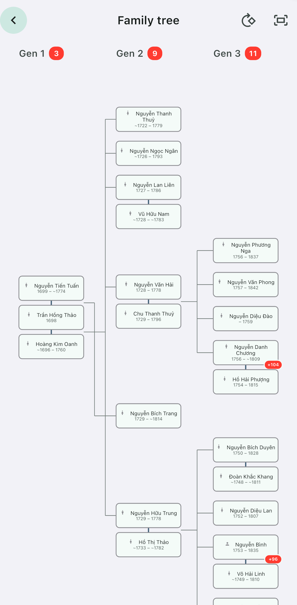
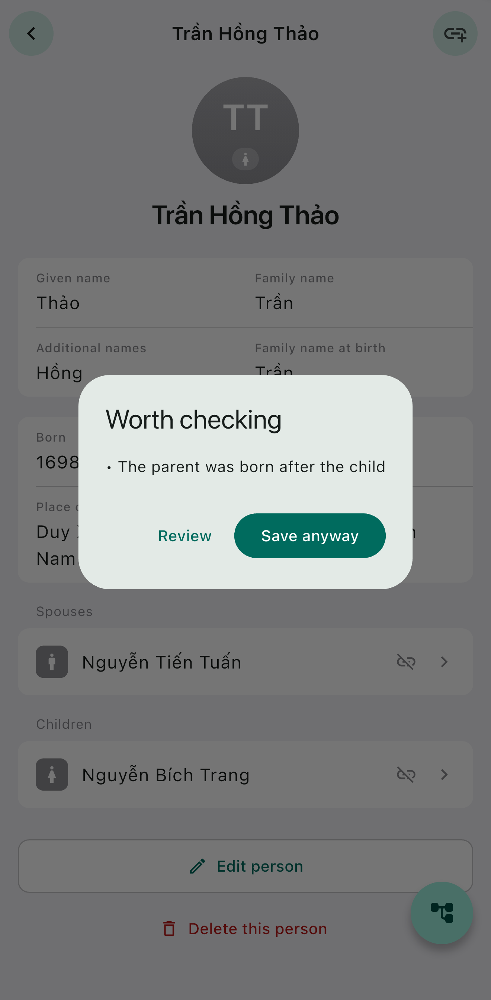
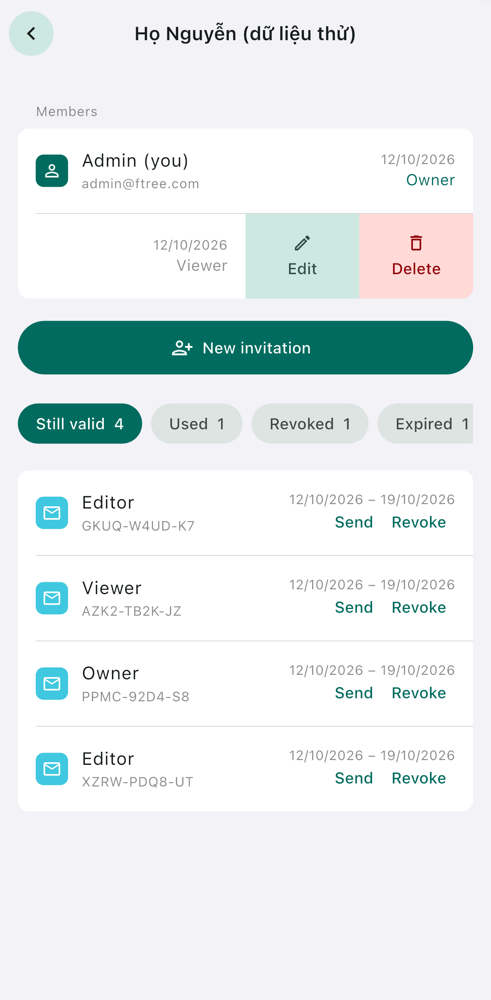

# Ftree

[](https://github.com/daviddoan-swe/ftree/actions/workflows/ci.yml)
[](LICENSE)

A private, offline-capable family tree application for iOS and Android, built
around a Vietnamese *gia phả* — a lineage written down and added to across
generations.

<p align="center">
  
  
  
</p>

<p align="center"><sub>
A chart that has to cope with two marriages · a warning that does not block ·
sharing one family with somebody else
</sub></p>

## The problem this is shaped by

Genealogical records are incomplete, inconsistent, and often correct anyway. A
birth known only as *1887*. A man with two wives and children under each. A
person with a recorded death but no date. Three centuries of entries where most
people have no dates at all.

Almost every convenient assumption is false here: that a date is a date, that
everybody has two parents, that one marriage is enough, that data which looks
wrong is wrong. So the interesting work is not the screens — it is deciding what
the model is allowed to refuse, and what it must be able to hold.

## Design decisions worth reading

Each is written up where it was decided, together with what reversing it costs.

* **[Partial dates are not nullable dates](docs/DOMAIN.md)** (§4.2) — a record
  known only as *1887* must not become 1 January 1887. The loss is user-entered,
  irreversible, and replicated to every device. No later migration recovers it.

* **[Sorting a partial order is not `sort`](docs/DOMAIN.md)** (§13.3) —
  comparing incomplete dates gives *before*, *after*, or *cannot tell*. A
  comparator answering "equal" to the third loses transitivity, which every sort
  algorithm assumes. An insertion pass moves an element only on evidence: the
  result can be incomplete, never wrong.

* **[Acyclicity is enforced, tolerated, and detected — never assumed](docs/DOMAIN.md)**
  (§6.2) — two devices editing offline can each add a valid parent-child edge
  that together close a cycle. Writes reject them, reads survive them, merges
  report them. Nothing silently drops an edge to restore the invariant.

* **[`updatedAt` must never resolve a conflict](docs/DOMAIN.md)** (§15.3) —
  device clocks drift and users change them, so last-write-wins hands every
  conflict permanently to whichever phone has the wrong date. Ordering comes
  from a server-assigned sequence instead.

* **[Validation returns severities, not a boolean](docs/DOMAIN.md)** (§9) —
  errors block, warnings do not. A model that only accepts or rejects will
  reject correctly transcribed records and be useless on real documents.

* **[Authorization belongs in the database](docs/ARCHITECTURE.md)** (§11) — the
  client ships a publishable key anybody can read, so PostgreSQL row-level
  security is the boundary. A mistake there is a security hole, not a UI defect.

* **[Decisions locked for V1, with the cost of changing each](docs/DOMAIN.md)**
  (§18) — eleven of them, scored by what reversal would cost, from *low* to
  *unrecoverable*.

## Architecture

```
Presentation  →  Application  →  Domain  →  Repository abstractions
                                              ↑
                                        Infrastructure
```

The domain layer is pure Dart: no Flutter, Riverpod, Drift, SQLite, Supabase or
platform APIs. Dart has no lint for import boundaries, so this is enforced by
[`test/architecture/domain_purity_test.dart`](test/architecture/domain_purity_test.dart)
rather than by convention — a test for an architectural property rather than for
behaviour.

A family's people and relationships are loaded in full and the graph is built in
memory. At the target scale that is a few megabytes, and it means validation,
traversal and layout all work against plain structures with no query planning to
design.

## Technology

| Layer | Choice |
| --- | --- |
| Client | Flutter / Dart |
| State management | Riverpod |
| Local persistence | Drift / SQLite |
| Cloud | Supabase — PostgreSQL, Auth, row-level security |

Platform targets are iOS and Android. `web/` is a development convenience for
inspecting graph and layout output quickly, not a release target.

## Status

Pre-release. [docs/ROADMAP.md](docs/ROADMAP.md) carries the current milestone.

The local application works: domain model, family graph, SQLite persistence,
tree rendering, and a family that can leave the device as a file. The cloud
schema, authentication and access policies exist and are exercised against a
PostgreSQL running locally — sharing a family and inviting somebody into it both
work. Synchronisation is partly built: a device pulls a family's changes down,
and pushing them back is the next step.

Covered by 1,206 tests, including migration tests that replay the schema as it
actually shipped rather than an approximation of it.

## Getting started

Requires the Flutter SDK on the stable channel.

```sh
flutter pub get
flutter analyze
flutter test
flutter run
```

Running on a physical device needs a signing identity, and the day-to-day
development loop — generated test data, resetting the database, the pre-commit
hook, running the cloud locally, changing either schema — is in
[CONTRIBUTING.md](CONTRIBUTING.md).

## Documentation

| Document | Contents |
| --- | --- |
| [docs/PRODUCT.md](docs/PRODUCT.md) | What the product is, who it's for, V1 scope |
| [docs/DOMAIN.md](docs/DOMAIN.md) | Domain model, invariants, and the decisions locked for V1 |
| [docs/ARCHITECTURE.md](docs/ARCHITECTURE.md) | Layering, persistence, cloud, and cost strategy |
| [docs/ROADMAP.md](docs/ROADMAP.md) | Milestones M0–M12 |
| [CLAUDE.md](CLAUDE.md) | Working agreement for AI-assisted development |

Read DOMAIN.md §18 before changing the schema — it lists the decisions that are
expensive or impossible to reverse once real data exists.

## Vietnamese terms

The documentation keeps the Vietnamese words for the things it is about, because
each names something English describes only loosely. Interface labels are in
English and Vietnamese both — these are the terms the *documentation* uses.

| Term | Meaning |
| --- | --- |
| **gia phả** | A Vietnamese family record: the book a lineage is written down in, kept and added to across generations |
| **giỗ** | The death anniversary, observed on the lunar date rather than the Gregorian one |
| **đời** | Generation, counted from the founding ancestor — a fact about a person, not about the chart on screen |
| **thuỷ tổ** | The founding ancestor the generations are counted from |
| **Con Cả** / **Con Thứ** | The eldest child / a younger child. A gia phả is read from Con Cả down |
| **can chi** | The sixty-year cycle that names years — Giáp Tý, Đinh Hợi. Repeats every 60 years, so a source giving only the name needs a century from the reader |
| **tháng nhuận** | The intercalary month of the lunar calendar: a year with one has two months of the same number |
| **Tết** | Lunar new year, where the lunar year changes mid-Gregorian-year |

## Continuous integration

Every push runs `flutter analyze --fatal-infos` and the full test suite
([`.github/workflows/ci.yml`](.github/workflows/ci.yml)) — the same two gates the
pre-commit hook expects before a commit, run somewhere other than the author's
laptop. The Flutter version is pinned, so a red badge means this code changed
rather than that the SDK moved.

## License

MIT — see [LICENSE](LICENSE).
